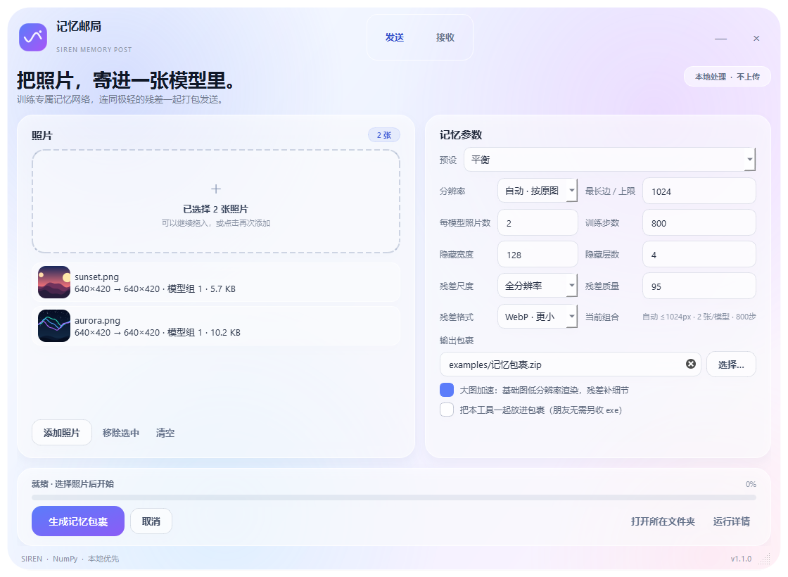
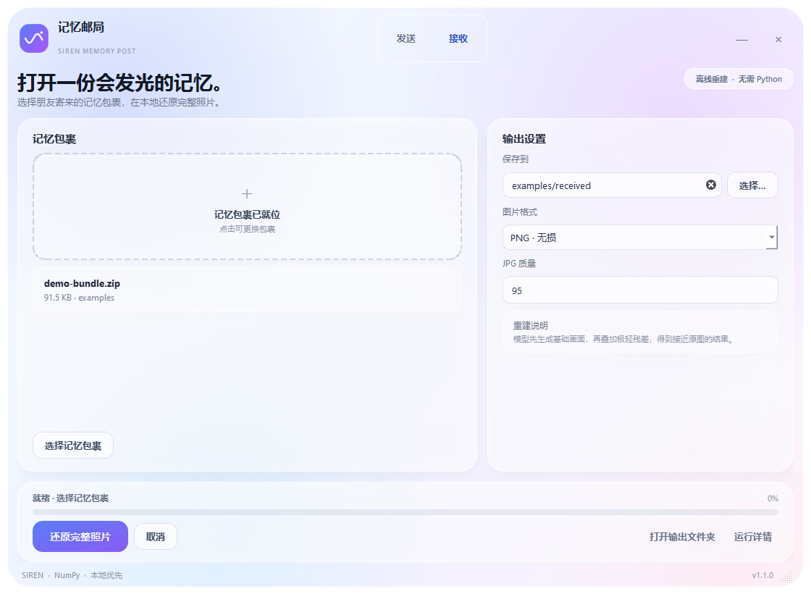

# 记忆邮局 · Memory Post

把照片训练成一个小型隐式神经表示，把模型和极轻的残差打包发给朋友；对方在本地离线重建完整照片。

> **Photos → SIREN model + residual → bundle.zip → reconstructed photos**

<p align="center">
  
  
</p>

## 这是什么

记忆邮局是一个 Windows 桌面工具：

- **发送端**：选择一张或几张照片，训练 SIREN 网络，压缩残差，生成 `bundle.zip`
- **接收端**：打开同一个程序，载入 `bundle.zip`，本地重建照片
- 发送端和接收端合并在一个 exe 中
- 接收端不需要 Python、PyTorch、CUDA 或联网

每张照片默认训练一个独立小模型。也可以设置 **每 2–8 张照片共用一个模型**。共享模型使用“共享隐藏主干 + 每图独立输出头”的结构，仍然是一个真正的单模型文件。

## 主要特性

- 单文件 Windows GUI：发送和接收在同一个程序里
- Apple 风格浅色玻璃界面，圆角窗口、半透明卡片、渐变按钮
- 支持多张照片、拖放、缩略图列表
- 默认每张照片一个模型
- 可选每模型照片数：1–8
- 自动按照片原始分辨率与比例决定训练尺寸
- 小图不放大；大图自动限制长边与像素总量
- 残差可选 WebP / PNG、全分辨率 / 1/2 / 1/4、质量可调
- 大图性能优化：混合特征缓存、按需采样、向量化 SSIM、大图基础图加速
- 后台训练与重建，可取消，可查看运行详情
- 完整离线；不依赖服务器，不上传照片

## 下载

从仓库的 [GitHub Releases](../../releases) 页面下载最新的 `MemoryPost.exe`。

> 当前 exe 未做代码签名，Windows SmartScreen 可能提示“未知发布者”。请从本仓库 Releases 下载，并可自行从源码构建。

## 使用方式

### 发送照片

1. 打开 `MemoryPost.exe`
2. 在“发送”页添加或拖入照片
3. 选择预设：快速 / 平衡 / 高画质 / 自定义
4. 可选设置：
   - 分辨率：自动按原图 / 固定长边
   - 每模型照片数：默认 1
   - 训练步数、隐藏宽度、隐藏层数
   - 残差尺度、质量与格式
   - 大图加速
5. 选择输出 `记忆包裹.zip`
6. 点击“生成记忆包裹”

如果朋友没有这个程序，可以勾选“把本工具一起放进包裹”，bundle 会增加约 52 MB；否则普通照片包裹通常只有 **0.1–0.3 MB**。

### 接收照片

1. 切换到“接收”页
2. 选择或拖入 `记忆包裹.zip`
3. 选择输出目录和 PNG/JPG
4. 点击“还原完整照片”

也可以直接把 ZIP 作为启动参数传给程序，程序会自动切到接收页并载入包裹。

## 每模型照片数

默认：

```text
1 张照片 = 1 个独立模型
```

设置为 2–8 时，按照片列表顺序分组：

```text
设置 2：
模型组 1 = 第 1、2 张
模型组 2 = 第 3、4 张
```

共享模型结构：

```text
共享 SIREN 隐藏主干
+ 每张照片一个独立输出头
+ 每张照片自己的残差
```

特点：

- 同组只有一个 `.npz` 模型文件
- 每张照片仍有独立输出头和残差
- 接收端通过 `head_index` 选择输出头
- 同组照片允许不同分辨率
- 训练时间大致随组内照片数线性增加

## 分辨率模式

默认使用：

```text
自动 · 按原图
```

规则：

- 小图不强行放大
- 保持原始宽高比
- 默认最长边上限 1024 px
- 默认总像素上限约 160 万
- 可在界面调整上限
- 也可切换“固定长边”模式

照片列表会显示：

```text
原图尺寸 → 训练尺寸 · 模型分组 · 文件大小
```

示例：

```text
800×600   → 800×600
512×341   → 512×341
3000×2000 → 1024×683
```

## 大图性能优化

### 混合特征缓存

- 小图在约 192 MB 预算内预缓存 Fourier 特征，训练更快
- 大图不一次性生成整张图的特征，只采样当前 batch 的像素
- 避免大图训练产生数百 MB 到数 GB 的临时数组

### 向量化 SSIM

- 旧版质量评估使用 Python 窗口循环
- 当前使用 NumPy 滑窗向量化
- 与旧结果误差小于 `1e-7`

### 大图基础图加速

超过约 90 万像素时：

1. 网络先以较低分辨率渲染基础图
2. 使用双三次插值放大到目标分辨率
3. 高分辨率残差补回细节

发送端会记录 `base_render_width` / `base_render_height`，接收端复现同样流程，保证残差叠加一致。

## 工作原理

```text
照片
  → 自适应分辨率
  → SIREN 训练
  → 生成基础图
  → 计算原图 − 基础图 = 残差
  → 残差压缩
  → 模型 + 残差 + manifest 打包为 ZIP
```

接收端：

```text
bundle.zip
  → 读取 manifest
  → NumPy 前向传播
  → 生成基础图
  → 叠加残差
  → 输出 PNG/JPG
```

更多细节见：

- [架构说明](docs/architecture.md)
- [Bundle 格式](docs/bundle-format.md)
- [性能设计](docs/performance.md)

## 示例

仓库包含可直接体验的文件：

- [示例图片](examples/images)
- [示例 bundle](examples/demo-bundle.zip)

用接收端打开 `examples/demo-bundle.zip` 即可看到两张示例图片的重建结果。

## 从源码运行

要求：Python 3.10+、Windows 10/11。

```powershell
git clone <repository-url>
cd memory-post
python -m venv .venv
.\.venv\Scripts\Activate.ps1
pip install -r requirements-dev.txt
python memory_post.py
```

也可以安装为 GUI 命令：

```powershell
pip install -e .
memory-post
```

## 构建 Windows exe

```powershell
.\build_exe.bat
```

输出：

```text
dist/MemoryPost.exe
```

构建使用 PyInstaller onefile 模式。程序图标位于 `assets/icon.ico`，版本信息位于 `packaging/version_info.txt`。

## 运行测试

```powershell
pip install -r requirements-dev.txt
pytest
```

最终 exe 还内置了完整自检：

```powershell
.\dist\MemoryPost.exe --selftest-full .\selftest-out
```

自检会训练两张测试图片、生成共享模型、重建图片、验证 manifest，并可校验内置 exe。

## 项目结构

```text
memory-post/
├─ memory_post.py          # 单独 GUI 入口，发送与接收页面
├─ sender.py               # 训练、残差、打包
├─ receiver.py             # bundle 载入与图片重建
├─ siren_common.py         # Fourier 特征、NumPy 前向传播、公共工具
├─ assets/                 # 图标
├─ packaging/              # PyInstaller 版本信息
├─ docs/                   # 架构、格式、性能与发布文档
├─ examples/               # 示例图片与 demo bundle
├─ tests/                  # pytest 测试
├─ .github/workflows/      # CI 与 Releases 构建
├─ build_exe.bat
├─ requirements*.txt
└─ pyproject.toml
```

## 已知限制

- 每张照片默认单独训练一个模型，不是通用图像生成模型
- 默认 800 步、4×128 的训练仍需几十秒到数分钟，取决于 CPU、图片大小和系统负载
- 共享模型的基础图 PSNR 通常略低于独立模型，但残差叠加后最终画质接近
- 结果是“接近肉眼无差别”，不是数学意义上的严格无损
- 输出分辨率由发送端的训练尺寸决定，不会恢复原图更高分辨率
- 当前没有生产级熵编码与率失真优化
- Windows exe 目前未签名

## 隐私

- 所有训练与重建都在本地完成
- 不包含遥测、统计上报或云端服务
- 只有你主动发送的 `bundle.zip` 会离开本机

## 参与贡献

欢迎提交 Issue 和 Pull Request。请先阅读 [CONTRIBUTING.md](CONTRIBUTING.md)。

## 许可证

[MIT](LICENSE)

---

## English summary

Memory Post is a Windows desktop tool that trains one or more photos into small SIREN implicit neural representations. It packages the model, compressed residual images, and a manifest into a ZIP. The same executable can open the ZIP and reconstruct the photos offline without Python, PyTorch, CUDA, or network access.

Key features: unified sender/receiver GUI, optional 1–8 photos per shared multi-head model, adaptive source resolution, WebP/PNG residuals, large-image performance optimizations, and a single-file PyInstaller build.
